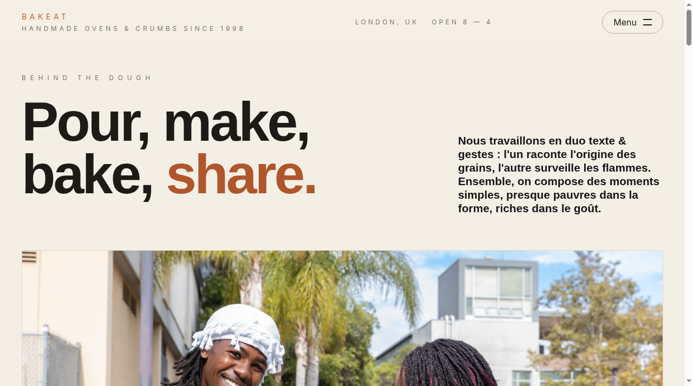
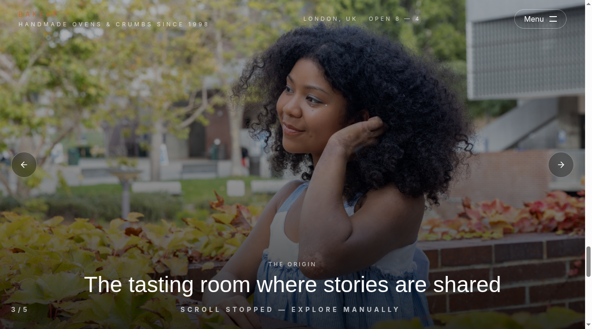
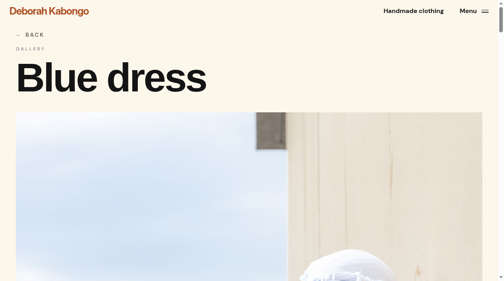

# DK-Shop 🥖

> An immersive landing page for **Bakeat**, an artisan bakery brand.

**Live demo:** [dkshop-omega.vercel.app](https://dkshop-omega.vercel.app)

## About

DK-Shop is a front-end concept site for a fictional artisan bakery ("Handmade ovens & crumbs since 1998"). The goal: practice high-end, award-site-style front-end techniques — smooth scrolling, custom cursor, scroll-triggered animations and full-screen photo galleries.

## Features

- **Immersive landing page** — hero, "Behind the Dough", artisans, full-screen origin story carousel and news sections
- **Smooth scrolling** — Lenis-powered inertia scrolling
- **Custom cursor** — a bespoke cursor that reacts to interactive elements
- **Scroll animations** — Framer Motion transitions throughout
- **Photo galleries** — full gallery pages with a lightbox viewer (`/gallery/:id`)
- **Full-screen menu overlay** and responsive layout

## Screenshots

| Home | Origin story |
| --- | --- |
|  |  |

| Gallery |
| --- |
|  |

## Tech Stack

- **React 18 + TypeScript + Vite** (SWC)
- **React Router** — landing + gallery routes
- **Tailwind CSS + shadcn/ui (Radix UI)**
- **Framer Motion** — animations
- **Lenis** — smooth scrolling
- **lucide-react** icons

## Getting Started

```bash
git clone https://github.com/Kbelony/DK-Shop.git
cd DK-Shop
npm install
npm run dev
```

Then open http://localhost:5173.

## Project Structure

```
src/
├── components/landing/  # hero, sections, navbar, footer, cursor, smooth scroll
├── components/gallery/  # gallery page + lightbox
├── hooks/               # useGallery data hook
├── services/            # gallery data service
└── assets/              # photography & styles (SCSS)
```
